# Hibiscus Teams

Player teams for NeoForge (Minecraft 26.3): parties with an owner, officers and members, invites, allies and enemies,
server teams run by the admins, team chat, team tags and colours, and friendly fire, all from a small screen by the
inventory or a full command set. Built on [Hibiscus Lib](https://github.com/hibiscus-software/hibiscus-lib), whose
Teams API it implements, so mods such as Hibiscus Quests keep their progress per team.

- **Requires:** NeoForge 26.3.0.0-beta or newer (every 26.3 build), Java 25, and Hibiscus Lib 1.4.1 or newer, on the server and every client.
- **License:** MIT.

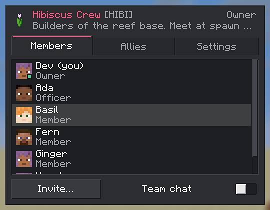

## Features

- **Every player has a team.** On your own you're in your *player team*, so team-based mods always have a team for
  you. Create or join a **party** to play together; leave it and you're back on your own team, with its data intact.
- **Ranks.** Each party has one **owner**, **officers** who can invite, remove members and change settings, and
  **members**. The owner promotes, demotes, hands over ownership and disbands; an owner can't leave until they've
  done one of the last two.
- **Invites and open parties.** Invite online or offline players; invites expire after a while (configurable). A
  party can be **free to join**, so anyone can join without an invite. Parties can have a member limit.
- **Allies and enemies.** Parties ask each other to be allies, and accept or decline; any party can mark another as an
  enemy.
- **Server teams.** Admins create teams with no owner ("Admins", "Spawn crew") and add players to them; a server team
  can be **locked**, so its members can't leave on their own.
- **Team settings:** name (unique), a 1-5 character **tag**, colour, description, an item as its icon, free to join,
  member limit, whether it takes ally requests, friendly fire, and team chat by default.
- **Friendly fire** is off within a team unless the team allows it (and optionally between allies too).
- **Team chat.** `/teams msg`, or make team chat your default and everything you type goes to your team; start a
  message with `!` to send it to everyone.
- **Tags and colours.** A member's `[TAG]` shows before their name in chat, the player list and above their head, and
  their name in the team's colour, through a mirror of the teams on the vanilla scoreboard (so vanilla clients and
  other mods see them too).
- **News as toasts and chat messages:** invites, new members, removals, ally requests, new owners, disbanded parties.
  Each player chooses toasts, chat or both.
- **Saved per team** as readable SNBT files in the world folder (`<world>/hibiscusteams/`), written safely with a
  backup, so a hand edit that goes wrong is reported and never written over.

## The Teams screen

Open it with the button beside the inventory (its badge counts your invites, and ally requests if you're an officer),
or bind the **Open Teams** key in Controls.

| On your own | Creating a party |
|---|---|
| 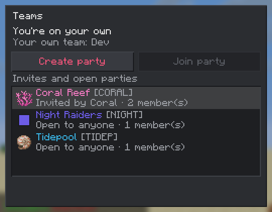 | 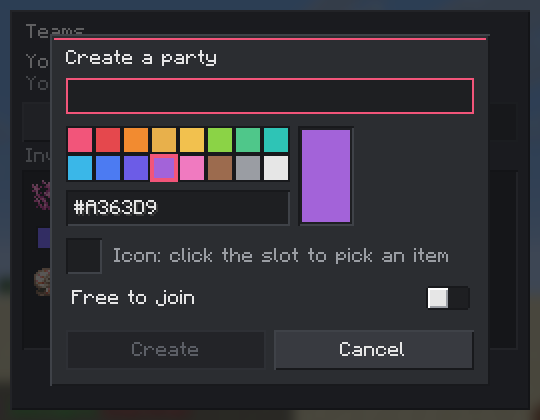 |
| **Members** (right-click a member) | **Inviting** |
| 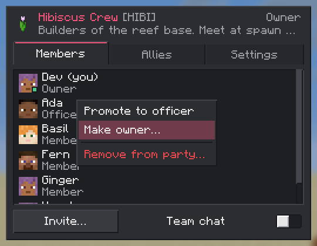 | 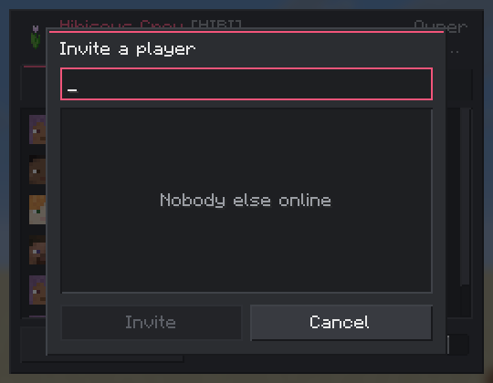 |
| **Allies** | **Adding an ally or enemy** |
| 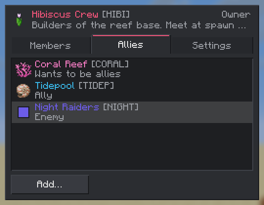 | 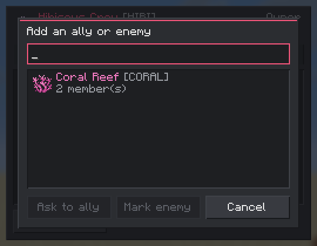 |
| **Settings** | **Settings, further down** |
| 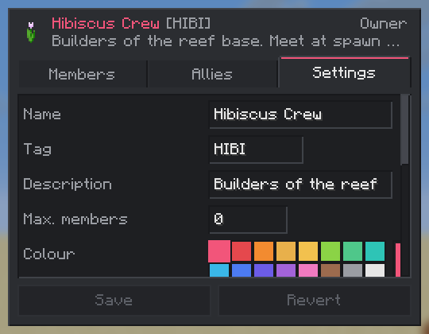 | 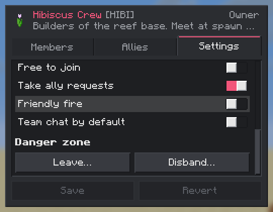 |
| **Settings, as a member** | **Disbanding** |
| 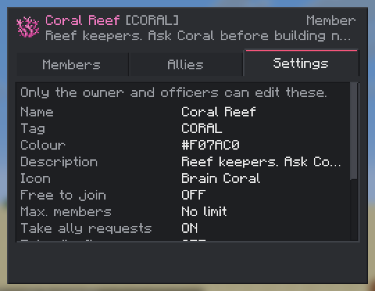 | 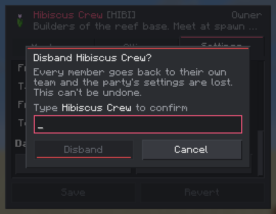 |

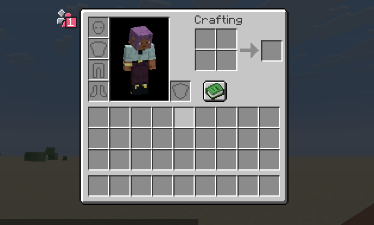

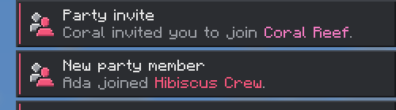

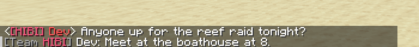

The screen updates as your team changes, fits GUI scales 1 to 4 (down to 427x240), and only ever shows what the server
has sent: every change is checked on the server, so the screen and the commands follow the same rules.

## Commands

`/hibiscusteams`, or its alias `/teams`. Team names with spaces can be quoted (`"Red Team"`); the last argument of a
command doesn't need quotes. Everything is suggested as you type.

### Players

| Command | What it does |
|---|---|
| `/teams` or `/teams info [team or player]` | Shows a team: yours, or the one named, or the player's |
| `/teams list [page]` | Lists parties and server teams (click one for its details) |
| `/teams party create <name>` | Creates a party with you as its owner |
| `/teams party invite <player>` | Invites a player (officers and the owner) |
| `/teams party join <team>` | Joins a party you're invited to, or one that's free to join |
| `/teams party accept [team]` / `decline [team]` | Answers an invite (the team can be left out if there's only one) |
| `/teams party leave` | Leaves your party |
| `/teams party kick <player>` | Removes a member ranked below you, or withdraws an invite |
| `/teams party promote <player>` / `demote <player>` | Makes a member an officer, or an officer a member (owner) |
| `/teams party transfer_owner <player>` | Hands the party to another member; you become an officer (owner) |
| `/teams party settings [<key> [<value>]]` | Lists, shows or changes a setting (officers and the owner) |
| `/teams party disband` | Asks you to confirm, then disbands the party (owner) |
| `/teams allies list` | Lists allies and ally requests |
| `/teams allies add <team>` | Asks a party to be allies (or accepts, if they asked first) |
| `/teams allies accept <team>` / `decline <team>` | Answers an ally request |
| `/teams allies remove <team>` | Ends an alliance, or withdraws your request |
| `/teams enemies list` / `add <team>` / `remove <team>` | Marks or unmarks a team as an enemy |
| `/teams msg <message>` | Sends a message to your team |
| `/teams chat` | Switches your chat between your team and everyone |

Setting keys: `name`, `tag`, `color` (`#RRGGBB`), `description`, `icon` (an item id, or `none`), `free_to_join`,
`max_members` (0 for no limit), `allow_ally_invites`, `friendly_fire`, `team_chat_default`, and for server teams
`locked`.

### Admins

Each group of admin commands has a permission node, granted to ops (level 2) by default, so a permissions mod can hand
them out more finely.

| Command | Permission node | What it does |
|---|---|---|
| `/teams server create <name>` | `hibiscusteams.admin.server` | Creates a server team |
| `/teams server delete <team>` | `hibiscusteams.admin.server` | Deletes a server team |
| `/teams server add <team> <player>` | `hibiscusteams.admin.server` | Puts a player in a server team |
| `/teams server remove <team> <player>` | `hibiscusteams.admin.server` | Takes a player out of a server team |
| `/teams server settings <team> [<key> [<value>]]` | `hibiscusteams.admin.server` | A server team's settings (also lets them be edited in the screen) |
| `/teams admin force_join <player> <team>` | `hibiscusteams.admin.members` | Moves a player into any party or server team |
| `/teams admin force_leave <player>` | `hibiscusteams.admin.members` | Takes a player out of their team (an owner's party passes to the next officer, else member) |
| `/teams admin rename <team> <name>` | `hibiscusteams.admin.rename` | Renames any team |
| `/teams admin disband <team>` | `hibiscusteams.admin.disband` | Disbands any party or server team |
| `/teams admin reload` | `hibiscusteams.admin.reload` | Saves, then loads every team from disk again (after hand edits) |
| `/teams admin export` | `hibiscusteams.admin.export` | Writes every team to `logs/hibiscusteams-export-<date>.json` |

## Configuration

### Server: `config/hibiscusteams-server.toml`

A world's `syncedconfig/hibiscusteams-server.toml` overrides it. Clients are sent a copy when they join.

| Key | Default | What it does |
|---|---|---|
| `parties.enabled` | `true` | Whether players may create parties (server teams work either way) |
| `parties.maxMembers` | `0` | The most members a party may have (0 for no limit); a party's own limit can only lower it |
| `parties.nameMaxLength` | `32` | The longest a team name may be (1-32) |
| `parties.allowFreeToJoin` | `true` | Whether parties may be free to join |
| `invites.expireMinutes` | `60` | Minutes before an invite or ally request lapses (0 for never) |
| `allies.enabled` | `true` | Whether parties may become allies |
| `allies.countForFriendlyFire` | `false` | Whether friendly fire protection covers allies' members too |
| `chat.showTag` | `true` | Show a member's `[TAG]` before their name |
| `chat.teamChatEnabled` | `true` | Allow team chat (`/teams msg`, `/teams chat`, `team_chat_default`) |
| `display.scoreboardMirror` | `true` | Mirror each team to a vanilla scoreboard team (`hbt_` and part of its id) for the player list, name tags and other mods. A party member leaves any other scoreboard team. Off: the mirrored teams are removed and the scoreboard is left alone |
| `display.nameTagColors` | `true` | With the mirror on, colour members' names in the nearest vanilla team colour |

### Client: `config/hibiscusteams-client.toml`

| Key | Default | What it does |
|---|---|---|
| `messages.toasts` | `true` | Show toasts for invites, new members, removals, ally requests, new owners and disbanded parties |
| `messages.chat` | `true` | Show team news in chat too (with its clickable buttons) |

Both files can also be edited from the Mods screen (Hibiscus Teams → Config).

## For mod developers: the Teams API

Hibiscus Teams implements [Hibiscus Lib's Teams API](https://github.com/hibiscus-software/hibiscus-lib/blob/main/docs/API.md).
Code written against it works the same with or without Hibiscus Teams: without it, every player is their own team.
Depend on Hibiscus Lib (see its `docs/DEPENDING.md`), not on Hibiscus Teams.

```java
import software.hibiscus.hibiscuslib.api.team.Team;
import software.hibiscus.hibiscuslib.api.team.TeamsApi;
import software.hibiscus.hibiscuslib.api.team.event.PlayerJoinedTeamEvent;

static final Identifier PROGRESS = Identifier.fromNamespaceAndPath("mymod", "progress");

// A player's team, on the server. Always a team: their party or server team, else their own player team (whose id
// is the player's UUID).
Team team = TeamsApi.get().teamOf(player);

// Data your mod keeps with the team, saved with it (server only; send clients what they need yourself).
CompoundTag progress = team.extraData(PROGRESS);
progress.putInt("completed", progress.getIntOr("completed", 0) + 1);
team.markDirty();

// Tell every online member.
for (ServerPlayer member : team.onlineMembers(server)) {
    member.sendSystemMessage(Component.literal("Your team completed a quest"));
}

// When a player's team changes (joining, leaving, being removed, a party disbanding), decide what happens to your
// data: keep it, merge it into the new team's, or start again.
@SubscribeEvent
static void onTeamChange(PlayerJoinedTeamEvent event) {
    CompoundTag from = event.from().extraData(PROGRESS);
    CompoundTag to = event.to().extraData(PROGRESS);
    to.merge(from);
    event.to().markDirty();
}
```

Events (on `NeoForge.EVENT_BUS`, server thread), in this order:

- `PlayerJoinTeamRequestEvent` before any join: cancel it with `deny(reason)` to stop the join, and the player is
  told the reason.
- Leaving, being removed or switching: `PlayerLeftTeamEvent` (with its reason) and then `PlayerJoinedTeamEvent` to
  the new team (the player team, after leaving).
- Disbanding: `TeamDeletedEvent` first, while the team's `extraData` can still be read, then `PlayerLeftTeamEvent` and
  `PlayerJoinedTeamEvent` for each former member.
- `TeamCreatedEvent`, `TeamPropertiesChangedEvent` (with what changed) and `TeamAlliesChangedEvent`.

On the client, `ClientTeams.myTeam()` is the local player's team (with its members) and `ClientTeams.knownTeams()` every
party and server team (name, tag, colour, member count). Use it for screens only; the server decides what anyone may
do.

## Building

```sh
./gradlew build                 # the mod jar in build/libs
./gradlew runGameTestServer     # Hibiscus Teams' and Hibiscus Lib's game tests
./gradlew runScreenshotClient   # every screen at GUI scales 1-4, into run/screenshotClient/screenshots/
```

Hibiscus Lib comes from GitHub Packages, which needs a token even for public packages: put `gpr.user` (your GitHub
user name) and `gpr.key` (a classic token with `read:packages`) in `~/.gradle/gradle.properties`. To work on Hibiscus
Lib at the same time, clone it next to this repository as `hibiscus-lib/`, or pass `-Phibiscuslib_dir=<path>`; the
build then uses your checkout instead.

Releases: see [docs/RELEASING.md](docs/RELEASING.md). Changes: [CHANGELOG.md](CHANGELOG.md).

## License

MIT; see [LICENSE](LICENSE). Hibiscus Teams is a clean-room implementation: FTB Teams was a reference for features
only, and none of its code, textures or text is used.
